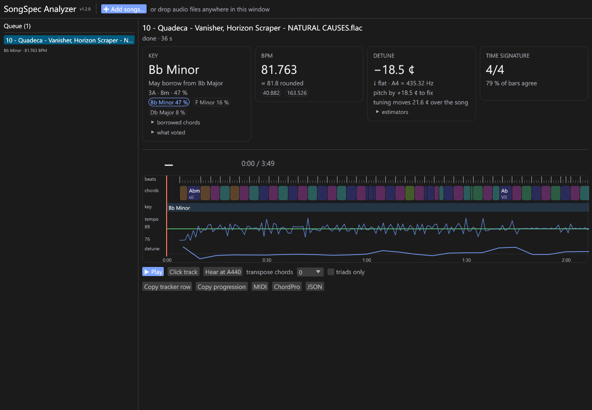

<div align="center">

<picture>
  <source media="(prefers-color-scheme: dark)" srcset="docs/logo-dark.svg">
  
</picture>

**Drop in a song. Get its key, BPM, chords, detune and borrowed chords, written the way the SongSpec tracker writes them.**




**[⬇ Download SongSpecAnalyzer.exe](https://github.com/songspec/songspec-analyzer/releases/latest)**

</div>

> [!NOTE]
> **Memory:** the desktop app idles at about **75 MB**, but while it is analysing a song it briefly uses up to about
> **2 GB** of RAM (the neural networks run several pieces of the song at once). It drops back to idle as soon as the queue is
> done. On a PC with 4 GB of RAM or less, close other heavy programs while it works.

---

## What you get

| | |
|---|---|
| **Key** | Key in tracker style (`Eb Minor`, `Db Major`, `Bb Minor*` with `A# Phrygian` for a mode), confidence, alternates, Camelot / Open Key, and key changes inside a song. |
| **May borrow from** | Which scales the song's chords borrow from, for example `May borrow from C Mixolydian, C Minor`. Covers every mode, harmonic / melodic minor, and minor keys borrowing from their major. |
| **BPM** | The exact tempo to three decimals (`134.759`) with the tracker's rounded reading (80–160, `~` for live, `153 / 104` for beat switches), half / double values and the time signature. Uses BPM Fixer's engine. |
| **Detune** | Cents off A440 and the A4 frequency (`−18.5 ¢`, `A4 = 435.32 Hz`), plus drift. Uses Centsible's engine. |
| **Chords** | Chords on the beat grid, with roman numerals (`i–VI–III–VII ×8`), on a timeline you can play along to (click track, hear it at A440, transpose), plus MIDI / ChordPro export. |
| **What voted** | Every key estimator's answer, for when you want to know *why*. |

---

## Three ways to use it

### 1. Desktop app (Windows)

One file, `SongSpecAnalyzer.exe`. Double-click it and drop songs in; nothing to install (no Python, no runtimes).
**Add songs** takes audio files or links: Spotify tracks, albums and playlists, Apple Music songs and albums, and YouTube videos
and playlists. A whole album is analysed song by song. Songs are analysed one after another; click one to see its results and
play it along the chord timeline.

Links are found on YouTube and downloaded with [yt-dlp](https://github.com/yt-dlp/yt-dlp), which the app fetches from its
official release the first time you need it (you confirm first). Downloaded audio stays in a temporary cache and is deleted when
the app closes.

Build it yourself: see **[rust/README.md](rust/README.md)**. It comes down to `cargo build --release -p songspec-app`.

### 2. On songspec.org (HTTP service + JS client)

```bash
docker compose -f docker/compose.yaml up --build        # API on :8000
```

```js
import { createClient } from "./client/analyzer-client.js";
const result = await createClient({ baseUrl }).analyzeFile(file, { onUpdate: render });
```

The client has no UI, so the site keeps full control of the look. Everything the site needs is in
**[INTEGRATION.md](INTEGRATION.md)**: endpoints, settings, what each field means and how to display it.

### 3. From Python or the command line

```python
from songspec_analyzer import analyze_file
r = analyze_file("song.mp3")
r["key"]["display"]["key"], r["tempo"]["bpm"], r["detune"]["cents"]
```

```bash
python -m songspec_analyzer song.mp3 --out result.json
```

---

## How accurate is it?

Measured on held-out songs from the SongSpec tracker; the full details are in **[eval/REPORT.md](eval/REPORT.md)**.

| | result |
|---|---|
| **BPM** | 86 % within 1 % of the tracker's BPM, 89 % within 4 % |
| **Detune** | 0.27 ¢ average error on exactly shifted real music; 100 % within 2 ¢ |
| **Key** | Right or a closely related key (MIREX score 0.60) on artists it never saw, with the most common error being the relative major / minor |
| **May borrow from** | Names one of the tracker's scales on 46 % of the songs where the tracker names one |
| **Desktop app vs the website** | Identical key, signature and detune on 20 / 20 test songs; BPM on 19 / 20 (one song is 0.1 BPM off) |

---

## Repository map

| | |
|---|---|
| `service/` | The Python analysis service (API, pipeline, every analysis stage) |
| `client/` | Headless JS client and house-style formatters for the site |
| `rust/` | The desktop app: `songspec-core` (engine), `songspec-app` (window), `songspec-cli` |
| `eval/` | Accuracy and parity measurements, and `REPORT.md` |
| `contract/` | The JSON schema of a result |
| `tools/` | Dev server, model fetchers, ONNX export, icon and logo makers, tester package |
| `docker/` | The production image |

More: [PLAN.md](PLAN.md) (design), [PROGRESS.md](PROGRESS.md) (what's done, with numbers), [LICENSES.md](LICENSES.md)
(third-party code and models).

```bash
.venv/Scripts/python tools/dev_server.py                  # API + test page on http://127.0.0.1:8765
cd service && ../.venv/Scripts/python -m pytest -q        # service tests
cd rust && cargo test --release -p songspec-core          # engine tests
```

---

## License

SongSpec Analyzer is free software under the **[GNU Affero General Public License v3.0 or later](LICENSE)** (AGPL-3.0+), like
Centsible. You may use, study, change and share it; if you distribute it, or run a modified version as a network service, you
must offer the source under the same licence. The models and libraries it uses are all MIT, Apache, BSD or similar; each one is
listed in **[LICENSES.md](LICENSES.md)**.

---

## Disclaimer

The **desktop app (the Rust code in `rust/`) was written 100 % with [Claude Code](https://claude.com/claude-code)**,
Anthropic's AI coding assistant. The **analyzer itself is about 70 % Claude Code and 30 % me**: the tempo engine comes from Deezy's
BPM Fixer, the detune and key core from Centsible, the house style and every label it is tested against from our tracker,
and the AI wrote most of the rest. I review what it writes, but I have not read every line, and AI-written code can contain
mistakes I missed.

The accuracy numbers above are measurements on our own song collection, not guarantees. Check the results that matter to you,
and if something looks wrong, tell me or open an issue.

---

<div align="center"><sub>SongSpec Analyzer reads your audio; it never changes your files.</sub></div>
